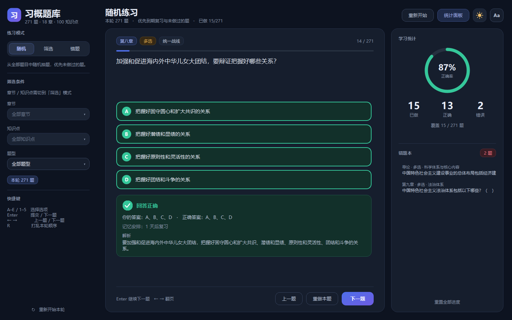

# 习概选择题 · FZU 期末复习刷题程序

> **仅适用于福州大学（FZU）《习近平新时代中国特色社会主义思想概论》课程的期末复习。**
>
> 题库来自课程下发的选择题汇总。其他院校、其他教材版本的考点表述可能不同，请勿直接套用。



## 功能

- **三种模式**：随机／筛选（章节 + 知识点 + 题型）／只做错题
- **智能出题顺序**：按「未掌握度 40% + 错误频率 25% + 提分性价比 15% + 知识点覆盖 12% + 考点频次 8%」打分，同一知识点不连出；不用时间间隔，随时打开都按当前掌握情况排（[算法说明](docs/ranking.md)）
- **即时反馈**：正确、错选、漏选分色标记，提交后给出正确答案、解析，以及本题的掌握度、累计错次与难度
- **错题本**：答错自动收录、答对自动移出，点击可跳转
- **深色模式**：右上角日 / 月按钮切换
- **键盘操作**：`A–E` / `1–5` 选择，`Enter` 提交或下一题，`←` `→` 翻页，`R` 打乱顺序

## 运行

**免安装版**：从 Releases 下载压缩包，解压后双击 `习概选择题.exe`。

**源码运行**（Python 3.10+）：

```bat
python -m venv .venv
.venv\Scripts\python -m pip install -r requirements.txt
.venv\Scripts\python -m app
```

也可以直接双击 `run.bat`，它会自检并准备环境。

## 题库

271 题 = 176 单选 + 95 多选。每题包含题干、全部选项、答案、解析与章节 / 知识点分类。

- 题库：`data/questions.json`

## 目录

```
app/      程序（UI 与业务逻辑分离）
data/     结构化题库
tools/    从 PDF/DOCX 重建题库、生成图标、打包 exe
tests/    端到端自测
docs/     数据报告、排序算法说明、截图、便携版说明
```

## 说明

- 做题记录保存在 `userdata/progress.json`，删除该文件即清空进度。
- 题库内容仅供课程复习使用。
